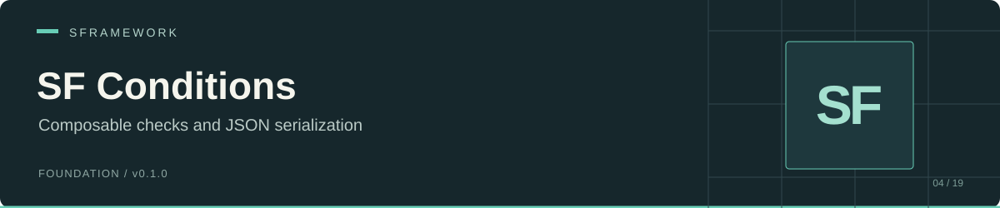

# SF Conditions

 

## Overview

SF Conditions provides Boolean condition objects, array evaluation helpers, and a Newtonsoft.Json converter for polymorphic rules. Your application implements each rule's `Met()` method; the package provides the contract, constructor injection, and a `$Type` JSON discriminator.

## Requirements

- `SFramework.Conditions.Runtime` references `SFramework.Core.Runtime`. Install [SF Core](https://github.com/huran438/sf-core) and its dependencies.
- Runtime source uses `Newtonsoft.Json` and `Newtonsoft.Json.Linq`. Supply Newtonsoft.Json to the assembly; its asmdef does not explicitly reference a Newtonsoft assembly or DLL.
- [package.json](package.json) declares Unity 6000.0, SF Core and Newtonsoft.Json. When installing from Git, provide a matching Core source in the project's UPM manifest.
- The runtime namespace is `SFramework.Modules.SFConditions.Runtime`, despite the assembly name. Application assemblies must reference `SFramework.Conditions.Runtime`, plus Core/Newtonsoft when using their APIs.

## Installation

In Unity Package Manager, choose **Add package from git URL**:

```text
https://github.com/huran438/sf-conditions.git#master
```

Or add this entry to `dependencies` in the host project's `Packages/manifest.json`:

```json
"sp.sframework.conditions": "https://github.com/huran438/sf-conditions.git#master"
```

Use a commit hash instead of `master` to pin a revision.

## Quick start

Create `ExampleConditions.cs` and attach the component to a scene GameObject. Concrete conditions used by the converter need a public parameterless constructor; this example has an implicit one.

```csharp
using System;
using Newtonsoft.Json;
using SFramework.Modules.SFConditions.Runtime;
using UnityEngine;

[Serializable]
public sealed class BooleanCondition : SFCondition
{
    public bool Value;
    public override bool Met() => Value;
}

public sealed class ExampleConditions : MonoBehaviour
{
    private void Start()
    {
        var settings = new JsonSerializerSettings();
        settings.Converters.Add(new SFConditionConverter());
        const string json = "[{\"$Type\":\"BooleanCondition\",\"Value\":true}]";
        var conditions = JsonConvert.DeserializeObject<ISFCondition[]>(json, settings);
        Debug.Log(conditions.AllMet()); // true
        Debug.Log(JsonConvert.SerializeObject(conditions, settings));
    }
}
```

Register dependencies before constructing/deserializing a condition that uses `[SFInject]`. `SFCondition` requests injection in its constructor, before JSON fields are populated. An injected method must not depend on those configured field values yet.

## API

| API | Purpose |
| --- | --- |
| `ISFCondition.Met()` | Boolean rule contract; extends Core's `ISFInjectable` and carries a JSON converter annotation. |
| `SFCondition` | Serializable abstract base that calls `this.Inject()` during construction. |
| `SFConditionConverter` | Discovers concrete condition types and reads/writes `$Type` JSON objects. |
| `AllMet(this ISFCondition[])` | Short-circuit AND evaluation. |
| `AnyMet(this ISFCondition[])` | Short-circuit OR evaluation. |
| `AllMet(bool editorAlwaysTrue)`, `AnyMet(bool editorAlwaysTrue)` | Return true when the argument and `Application.isEditor` are true; otherwise use normal evaluation. |
| `IsEmpty(this IEnumerable<ISFCondition>)` | True for a null or empty collection. |

| Input | `AllMet()` | `AnyMet()` |
| --- | --- | --- |
| Null array | `true` | `true` |
| Empty array | `true` | `false` |
| All rules true | `true` | `true` |
| All rules false | `false` | `false` |
| Mixed results | `false` | `true` |

## Behavior and limitations

- Null elements throw when evaluation reaches them. Both evaluation helpers short-circuit. The editor override also applies in Editor Play Mode; the package supplies no built-in domain rules or composite classes.
- `$Type` is required. The converter accepts case-sensitive short class names that resolve to one compatible condition. When short names collide, use the full type and simple assembly names, for example `"MyGame.Rules.HasFuel, MyGame.Runtime"`. The converter writes the qualified form when necessary. Missing, unknown, incompatible, and ambiguous IDs throw `JsonSerializationException`.
- The converter scans loaded assemblies when constructed and skips types whose metadata cannot load. Later-loaded types are absent from that instance's map. Verify reflection and stripping in your player.
- Reading and writing use public instance fields and properties that can be both read and written. Indexers, methods, read-only members and `[JsonIgnore]` members are skipped. `[JsonProperty("name")]` supplies a JSON name; reading still accepts the original member name, matches without case sensitivity when needed, and ignores unknown keys.
- Nested conditions and condition arrays use the same serializer; JSON null reads as null.
- Core builds injection metadata during runtime initialization. Earlier construction can receive no injection; inject explicitly later after metadata and bindings exist. Implementing `ISFCondition` directly does not request injection automatically.

## Tests

Package tests are in [Tests/Editor](Tests/Editor), in assembly `SFramework.Conditions.Editor.Tests`. Install Unity Test Framework and add this package ID to the **top-level** `testables` array in the host project's `Packages/manifest.json`, preserving existing entries:

```json
"testables": ["sp.sframework.conditions"]
```

Open **Window > General > Test Runner**, choose **EditMode**, and run the package tests with the requirements above installed. The local `sf-demo` host enables all SFramework package tests. Test assemblies are included under `UNITY_INCLUDE_TESTS`.

## License

MIT. See [LICENSE.md](LICENSE.md).
