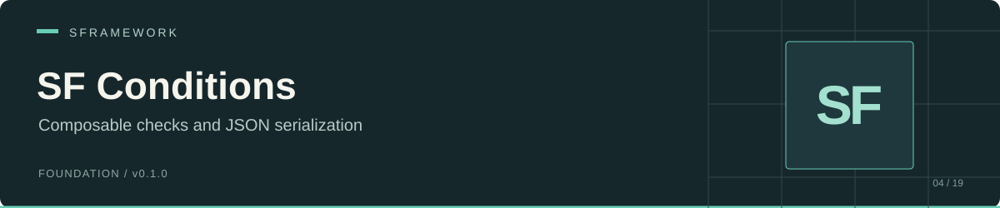

# SF Conditions

[Documentation website](https://docs.secretplace.studio/#sf-conditions)

 

SF Conditions defines Boolean condition objects, array evaluation helpers, and a Newtonsoft.Json converter for polymorphic conditions. Use it to describe rules in JSON and evaluate them through a shared `Met()` contract.

Your project implements the actual rules. The package supplies the condition interface, a base class that requests SF Core injection, and serialization support using a `$Type` discriminator.

[Installation](#installation) · [Example](#example) · [Injection](#injection) · [Evaluation semantics](#evaluation-semantics) · [JSON contract](#json-contract) · [API and repository map](#api-and-repository-map)

## Installation

In Unity Package Manager, choose **Add package from git URL**:

```text
https://github.com/huran438/sf-conditions.git#master
```

Alternatively, add this entry to `Packages/manifest.json` inside `dependencies`:

```json
"sp.sframework.conditions": "https://github.com/huran438/sf-conditions.git#master"
```

The [manifest](package.json) declares an empty dependency object and `unity: "2019.4"`. Its description and keywords refer to configs, while the current runtime source implements conditions. Treat the Unity field as package metadata: the source includes modern syntax such as `is not`, and no editor compatibility test accompanies this README.

| Required code or assembly | Evidence | Host-project setup |
| --- | --- | --- |
| `SFramework.Core.Runtime` | [Assembly definition](Runtime/SFramework.Conditions.Runtime.asmdef); `ISFCondition` inherits `ISFInjectable` | Install [SF Core](https://github.com/huran438/sf-core) and its dependencies. |
| `Newtonsoft.Json`, `Newtonsoft.Json.Linq` | [Converter](Runtime/SFConditionConverter.cs) and [interface](Runtime/ISFCondition.cs) | Supply Newtonsoft.Json in a form accessible to this assembly. The manifest does not declare it, and the asmdef has no explicit Newtonsoft reference. |

A custom application assembly must reference `SFramework.Conditions.Runtime`, `SFramework.Core.Runtime`, and the assembly supplying Newtonsoft.Json when it uses the example. Resolve missing assembly or namespace errors before running it.

## Example

Create `ExampleConditions.cs` and add the component to a scene GameObject. The converter needs the concrete condition class to have a public parameterless constructor; this example uses the implicit constructor.

```csharp
using System;
using Newtonsoft.Json;
using SFramework.Modules.SFConditions.Runtime;
using UnityEngine;

[Serializable]
public sealed class BooleanCondition : SFCondition
{
    public bool Value;
    public override bool Met() => Value;
}

public sealed class ExampleConditions : MonoBehaviour
{
    private void Start()
    {
        var settings = new JsonSerializerSettings();
        settings.Converters.Add(new SFConditionConverter());

        const string json = "[{\"$Type\":\"BooleanCondition\",\"Value\":true}]";
        var conditions = JsonConvert.DeserializeObject<ISFCondition[]>(json, settings);

        UnityEngine.Debug.Log(conditions.AllMet()); // true
        UnityEngine.Debug.Log(conditions.AnyMet()); // true
        UnityEngine.Debug.Log(JsonConvert.SerializeObject(conditions, settings));
    }
}
```

The equivalent JSON is:

```json
[
  {
    "$Type": "BooleanCondition",
    "Value": true
  }
]
```

The converter records the short CLR class name, rather than a namespace-qualified type name. Keep condition class names unique across the loaded assemblies.

## Injection

`ISFCondition` extends Core's marker interface. [`SFCondition`](Runtime/SFCondition.cs) calls `this.Inject()` from its constructor, so annotated members can receive dependencies from `SFContainer`.

Register dependencies before constructing or deserializing a condition that uses `[SFInject]`. Construction triggers injection before the converter populates JSON fields. An annotated method that runs during injection must not depend on those JSON fields already having their configured values.

Core builds its injection metadata during Unity runtime initialization. Construction outside that lifecycle can receive no injection. If your application constructs conditions earlier, arrange a later explicit `SFContainer.Inject(condition)` after bindings and metadata exist. Implementing `ISFCondition` directly does not call injection for you.

## Evaluation semantics

[`SFExtensions`](Runtime/SFExtensions.cs) defines `AllMet` and `AnyMet` for `ISFCondition[]`. Both short-circuit; they call each rule's `Met()` only until they know the result.

| Array | `AllMet()` | `AnyMet()` |
| --- | --- | --- |
| `null` | `true` | `true` |
| Empty | `true` | `false` |
| Nonempty, all rules return `true` | `true` | `true` |
| Nonempty, all rules return `false` | `false` | `false` |
| Mixed results | `false` | `true` |

A null element throws if evaluation reaches it. Validate array contents before evaluating them.

The overloads `AllMet(bool editorAlwaysTrue)` and `AnyMet(bool editorAlwaysTrue)` return `true` when the argument is `true` and `Application.isEditor` is true. That includes Editor Play Mode. Outside the editor they use the normal rules.

`IsEmpty(this IEnumerable<ISFCondition>)` returns `true` for a null or empty collection. The package provides no built-in domain rules or composite AND/OR condition classes.

## JSON contract

[`SFConditionConverter`](Runtime/SFConditionConverter.cs) scans loaded assemblies when you construct it and stores concrete `ISFCondition` classes by `Type.Name`. `ISFCondition` also carries a `[JsonConverter(typeof(SFConditionConverter))]` annotation; the example registers the converter in settings to make converter selection explicit.

| Behavior | Current implementation |
| --- | --- |
| Type selection | Exact `$Type` field with a case-sensitive short class name. Missing or unknown types throw `JsonSerializationException`. |
| Object construction | `Activator.CreateInstance(type)`; requires a public parameterless constructor. |
| Reading members | Match public instance members by name, ignoring case; populate fields or writable properties. Unknown names are skipped. |
| Writing members | Write public instance fields, including inherited public fields. Properties do not appear in the output. |
| Nested conditions | Serialize condition-valued fields and condition arrays through the same serializer. |
| JSON `null` | `ReadJson` returns `null`. |

Use public fields when you need a read/write round trip. The converter finds top-level members through reflection and does not use `JsonProperty` names or `JsonIgnore` to choose those members. Match JSON keys to CLR names, avoid keys that match methods or non-writable properties, and keep injected service references in private fields.

Two concrete condition classes with the same short name cause converter construction to fail because the dictionary requires unique keys. The assembly scan has no `ReflectionTypeLoadException` recovery. New types loaded after converter construction do not enter that instance's type map. Verify reflection discovery and stripping in your target player.

For a missing `$Type` error, add the discriminator with the class's exact name. For missing JSON values after serialization, check whether you used properties instead of public fields. For a null injected dependency, check registration and constructor timing in SF Core.

## API and repository map

Runtime types use `SFramework.Modules.SFConditions.Runtime`; the assembly name is `SFramework.Conditions.Runtime`.

| Source / API | Responsibility |
| --- | --- |
| [ISFCondition](Runtime/ISFCondition.cs) / `bool Met()` | Condition contract, injection marker, JSON annotation. |
| [SFCondition](Runtime/SFCondition.cs) | Serializable abstract base with constructor injection. |
| [SFConditionConverter](Runtime/SFConditionConverter.cs) | Type discovery, `$Type` JSON read/write. |
| [SFExtensions](Runtime/SFExtensions.cs) | `AllMet`, `AnyMet`, editor override, `IsEmpty`. |
| [Assembly definition](Runtime/SFramework.Conditions.Runtime.asmdef), [package.json](package.json) | Assembly reference and package metadata. |

## Related modules, validation, and license

See [SF Core](https://github.com/huran438/sf-core) for service registration and injection. [SF Configs](https://github.com/huran438/sf-configs) is a separate public module for configuration workflows.

This README describes source snapshot `4662a6807e24e44ebfdf4494efa94f5ec0b0627b`. The example was inspected statically against the source; it was not compiled or executed in Unity. Verify JSON round trips, injection timing, and the target player in your host project.

MIT License. See [LICENSE.md](LICENSE.md).
